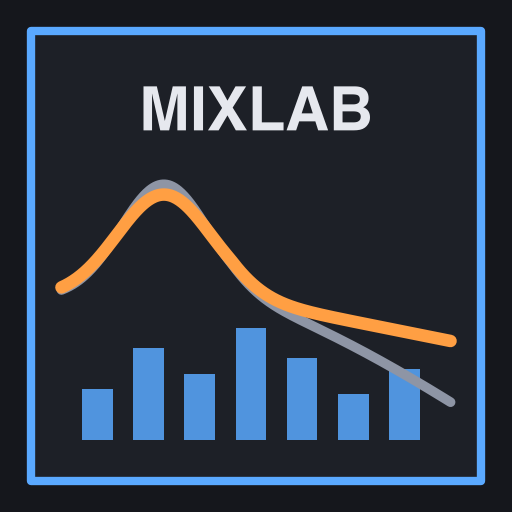
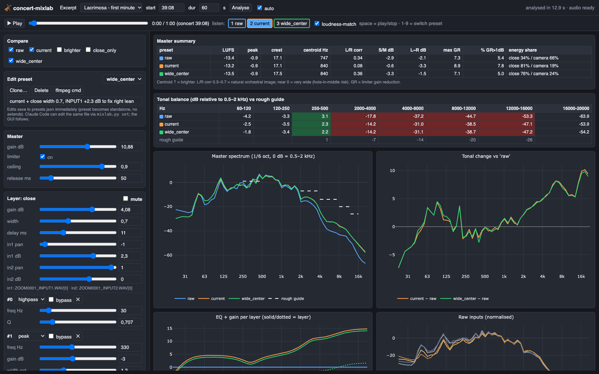
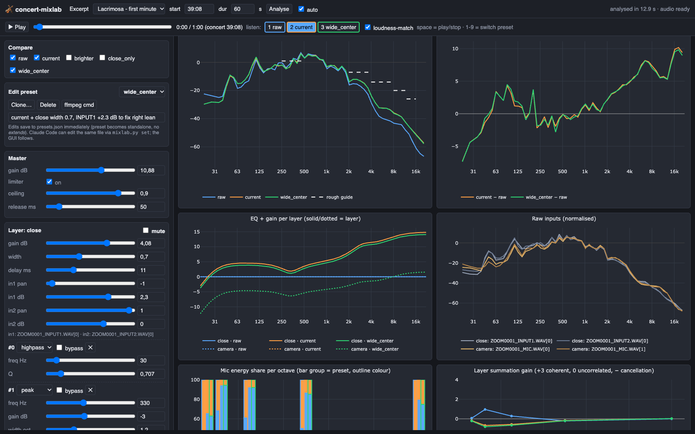

<p align="center"></p>

<h1 align="center">concert-mixlab</h1>

<p align="center">
<b>Mix, measure and A/B multi-mic concert recordings, with a live GUI that Claude Code can drive.</b><br>
Orchestra · choir · soloists · EQ · mic balance · time alignment · stereo image · loudness
</p>

---

You recorded a concert with a couple of microphones, say a spaced pair near the stage plus a stereo camera or recorder further back. The result sounds dull, muddy or lopsided. **concert-mixlab** turns the mix into a set of named presets you can tweak, measures what each setting does, and lets you hear the difference instantly. You can do it yourself with sliders, or ask Claude to try ideas for you while you listen.



## Contents
- [Features](#features)
- [Install](#install)
- [Quick start](#quick-start)
- [Using it with Claude Code](#using-it-with-claude-code)
- [The GUI](#the-gui)
- [How the mix is modelled](#how-the-mix-is-modelled)
- [Reading the analysis](#reading-the-analysis)
- [CLI reference](#cli-reference)
- [Files and data](#files-and-data)
- [Accuracy and verification](#accuracy-and-verification)
- [Troubleshooting](#troubleshooting)

## Features

| | |
|---|---|
| 🎛 **Preset-based mixing** | Layers of mics with pan, width, delay, an EQ chain and gain, plus a master limiter. Presets can inherit from each other. |
| 📈 **Analysis** | Spectrum against a tonal guide, EQ curves, each mic's share of the energy per octave, coherent/cancelling summation, L/R correlation and width per octave, vectorscope, LUFS/peak/crest, limiter activity, GCC-PHAT time alignment |
| 📟 **Live meters** | Spectrum analyser (relative view with guide + long-term overlay, peak hold), vectorscope with persistence, correlation meter, L/R peak/RMS with hold, limiter input + gain-reduction meters and an 8-second GR history, all following what you hear |
| 🎚 **DAW recipe** | A panel (and `mixlab daw`) listing the exact settings of the preset you're listening to: track fader/pan, bus delay/EQ (as Q)/width/fader, master gain and limiter. Copy or download it as text. |
| 🎧 **Gapless A/B playback** | All presets play in sync. Switch with keys 1–9, optionally loudness-matched so you judge tone, not volume. Edits update the audio while it plays. |
| 🤖 **Claude-drivable** | A skill plus slash commands let Claude clone a preset, try changes, measure them and put the result in your GUI for you to listen to |
| 🎬 **ffmpeg export** | Every preset becomes an equivalent `ffmpeg` command for rendering the full concert. The Python DSP matches ffmpeg to −77 dB. |
| 📄 **Static reports** | One HTML file with every graph and table, handy for sharing or archiving |

## Install

**Requirements:** macOS or Linux, Python ≥ 3.10, [ffmpeg](https://ffmpeg.org) (`brew install ffmpeg`), and optionally [uv](https://github.com/astral-sh/uv) for a faster setup.
The Python environment (numpy, scipy, matplotlib, plotly) is created automatically on first use in `~/.concert-mixlab/.venv`.

### As a Claude Code plugin

```bash
# from a local clone
git clone <this-repo> ~/GitHubProjects/concert-mixlab
claude plugin marketplace add ~/GitHubProjects/concert-mixlab
claude plugin install concert-mixlab@concert-mixlab

# or straight from GitHub
/plugin install concert-mixlab --marketplace <owner>/concert-mixlab
```

Check it with `claude plugin details concert-mixlab`. It should list the skills `concert-mixlab`, `gui`, `analyze`, `tune` and `setup`.

### Standalone (no Claude)

```bash
git clone <this-repo> concert-mixlab && cd concert-mixlab
bin/mixlab list          # first run sets up the venv and ~/.concert-mixlab/presets.json
bin/mixlab-gui           # opens http://127.0.0.1:8765
```

## Quick start

```bash
bin/mixlab source "~/Recordings/Requiem"            # where your WAVs are; lists files, channels and length
bin/mixlab show --preset raw --short                # check which files map to which layer
bin/mixlab source --excerpt "Lacrimosa" 39:08 180   # bookmark passages you care about
bin/mixlab-gui                                      # tweak, look, listen
```

The bundled `presets.example.json` expects a Zoom-style recording:
- `ZOOM0001_INPUT1.WAV` / `ZOOM0001_INPUT2.WAV`: mono close/spot mics → layer `close`
- `ZOOM0001_MIC.WAV`: the built-in stereo mic → layer `camera`

For other file names, run `/concert-mixlab:setup` and Claude maps them for you, or use `mixlab set` (see below).

## Using it with Claude Code

| Slash command | What it does |
|---|---|
| `/concert-mixlab:setup <folder>` | Points at your recordings, maps the files to layers and checks the chain |
| `/concert-mixlab:gui [excerpt]` | Starts the GUI and optionally jumps to a saved excerpt |
| `/concert-mixlab:analyze [presets]` | Measures and compares presets, then suggests 1–3 testable changes |
| `/concert-mixlab:tune <goal>` | Clones your preset and iterates toward the goal, stopping when the numbers improve without side effects. It then lines up base vs result in the GUI. |

The **`concert-mixlab` skill** also loads by itself when you talk about a concert mix, so you can just ask:

> *"The choir sounds dull in the Lacrimosa and the image leans right. Try something and let me compare."*

Claude works on a **clone** of your preset, never on your originals. It uses `mixlab set` / `metrics` and then calls `mixlab state --compare base,clone`. Your open GUI switches to the comparison within about 2 seconds, and you press 1/2 to hear it.

## The GUI



- **Limiter:** on/off. When it's off, ceiling (dBFS), attack and release are greyed out, the meters show *LIMITER OFF*, and a warning appears if the master clips. Overs reach the meters unclipped (float audio), and the clip LED lights at 0 dBFS.
- **Busy indicator:** while a change is being analysed, the numbers dim and "updating" shows. Only the edited preset is re-analysed, which takes about 0.5–3 s.
- **Header:** excerpt picker (saved bookmarks or any start/duration), Analyse, and *auto* (re-analyse after every edit).
- **Transport:** play/stop (space), seek, one button per compared preset (keys 1–9), loudness-match toggle. The time display shows both the excerpt time and the concert time.
- **Compare:** tick the presets to analyse and audition side by side.
- **Editor:**
  - every parameter has a slider and a number field
  - add, remove or bypass filters, and change filter types
  - mute layers, adjust per-input pan and gain
  - clone, delete, or show the ffmpeg command
  - changes save to `presets.json` straight away
- **Live monitor (sticky):**
  - vectorscope, correlation, output L/R meters (RMS bar, peak line, 1.5 s hold)
  - limiter input peak against the ceiling, limiter gain reduction, and its last 8 s
  - limiter readings come from the render and follow the playhead; the other meters measure the audio you hear
- **DAW settings, what you hear:** the active preset translated into DAW terms:
  - tracks: fader and pan
  - buses: delay in ms and samples, EQ bands with frequency/gain/Q, width as M/S side gain, fader
  - master: gain into the limiter, ceiling, attack, release
  - *Copy as text* / *Download .txt*
  - loudness-match is monitoring only and never part of the settings
- **Graphs and tables:** summary metrics, tonal-balance table coloured against the guide, master spectrum, change against the first preset, EQ curves, raw inputs, mic energy share, summation gain, correlation and side/mid per octave, vectorscopes, short-term loudness and limiter gain reduction, alignment table.
- **Follows external changes:** if `presets.json` or `state.json` changes (from Claude, the CLI or an editor), the GUI reloads and re-analyses.

## How the mix is modelled

```
layer:  inputs ──(pan, gain per input)──► width (M/S) ──► delay ──► filters ──► gain ─┐
layer:  …                                                                             ├─► Σ ──► master gain ──► look-ahead limiter ──► out
```

```jsonc
"current": {
  "extends": "raw",                                   // inherit; layers merge by name
  "description": "The chain used for the demos.",
  "layers": [
    { "name": "close",
      "inputs": [ {"file": "ZOOM0001_INPUT1.WAV", "ch": 0, "pan": -1},
                  {"file": "ZOOM0001_INPUT2.WAV", "ch": 0, "pan":  1} ],
      "width": 1.0, "delay_ms": 11, "gain_db": 4.08,
      "filters": [ {"type": "highpass",  "f": 30},
                   {"type": "peak",      "f": 330,  "oct": 1.2, "g": -3},
                   {"type": "peak",      "f": 3000, "oct": 1.5, "g": 4},
                   {"type": "highshelf", "f": 5000, "g": 10, "slope": 0.7} ] },
    { "name": "camera", "gain_db": -4.44, "filters": [ … ] }
  ],
  "master": { "gain_db": 10.88, "limiter_ceiling": 0.9, "attack_ms": 5, "release_ms": 50 }
}
```

| Filter | Parameters |
|---|---|
| `highpass` / `lowpass` | `f`, `q` (0.707) |
| `peak` | `f`, `oct` (bandwidth in octaves), `g` (dB) |
| `highshelf` / `lowshelf` | `f`, `g`, `slope` (0.1–1) |
| any filter | `"bypass": true` |

Other fields:
- **Layer:** `invert` (polarity Ø), `mute`, `width` (1 = unchanged, 0 = mono, >1 = wider).
- **Input:** `pan` (−1…1, constant power), `gain_db` and `invert`.
- **Master:** `limiter_ceiling` is linear; `null` turns the limiter off.

## Reading the analysis

| Metric | Meaning | Rule of thumb |
|---|---|---|
| Tonal balance | Band level relative to 0.5–2 kHz | 250–500 Hz ≈ +1 · 2–4k ≈ −7 · 4–8k ≈ −14 · 8–12k ≈ −20 · 12–16k ≈ −26 dB |
| Centroid | Spectral "centre of mass" | higher = brighter |
| L/R correlation | 1 = mono, 0 = uncorrelated | 0.3–0.7 natural; ≈0 hole in the middle; <0 phasey |
| Side/Mid | Width energy ratio | higher = wider |
| L−R | Level balance | aim for within ±1.5 dB |
| Energy share | Each layer's share of the master | the ambient layer usually sits at 20–35% |
| Summation gain | Actual sum vs energy sum, per octave | +3 coherent, 0 uncorrelated, **negative = cancellation**, so check the delay |
| Limiter GR | Gain reduction | above about 5% of the time over 1 dB = squashed |
| Mic alignment (summary) | Residual timing between layers after each preset's delays, plus the first comb-filter notch and a **polarity check** (signed GCC-PHAT; "Ø polarity wrong" = low frequencies cancel) | under 0.1 ms green; the measured raw lag and the delay that fixes it are shown below the table |
| Clip | % of samples ≥ 0 dBFS (limiter off) | must be 0; the editor warns and suggests how much to lower the master |
| Alignment | GCC-PHAT lag between inputs | trust only IQR < 2 ms; measure on sparse or a-cappella passages |

The tonal "guide" is a rough rule of thumb for an open concert-hall balance, **not a standard**. Your ears decide.

## CLI reference

All commands run as `bin/mixlab <command>`. Inside Claude Code the same commands run via `${CLAUDE_PLUGIN_ROOT}/bin/mixlab`.
`--start` / `--dur` default to the excerpt currently shown in the GUI.

| Command | Purpose |
|---|---|
| `list` | Config path, source folder, presets, excerpts, GUI state |
| `source [DIR] [--excerpt NAME START DUR]` | Set the recordings folder, save an excerpt, list audio files |
| `show --preset P [--short]` | Resolved preset as JSON, or a readable chain with filter indices |
| `clone SRC DST [--description …]` | Copy a preset |
| `set --preset P path=value …` | Edit parameters (see below) |
| `delete --preset P` | Remove a preset (refused if another preset extends it) |
| `state [--excerpt N] [--start] [--dur] [--compare a,b] [--edit P]` | Read or steer the GUI |
| `metrics [--presets a,b] [--align]` | Compact JSON analysis (made for agents) |
| `report [--presets a,b] [--out DIR] [--render]` | Static HTML report (+ WAV per preset) |
| `render --preset P --out x.wav [--fade s]` | Render an excerpt with the Python chain |
| `ffmpeg --preset P [--start 0 --dur 0] --out full.wav` | Print the equivalent ffmpeg command (`--dur 0` = whole file) |
| `verify --preset P` | Null-test the Python DSP against ffmpeg |
| `daw --preset P [--json]` | DAW recipe: track fader/pan, bus delay/EQ (Q)/width/fader, master gain + limiter |

`set` paths address layers by **name** and lists by **index**. Values are JSON, and `delete` removes an entry:

```bash
bin/mixlab clone current try1
bin/mixlab set --preset try1 layers.close.width=0.7 layers.close.inputs.0.gain_db=2.3
bin/mixlab set --preset try1 layers.close.filters.3.g=12 layers.camera.mute=true
bin/mixlab set --preset try1 'layers.close.filters.4={"type":"peak","f":9000,"oct":1,"g":2}'   # append
bin/mixlab set --preset try1 layers.close.filters.1=delete
bin/mixlab state --compare current,try1 --edit try1
```

Render the whole concert with a preset:

```bash
eval "$(bin/mixlab ffmpeg --preset try1 --start 0 --dur 0 --out ~/Desktop/concert_try1.wav)"
```

## Files and data

```
concert-mixlab/                     (the plugin — code only, safe to update)
├── .claude-plugin/                 plugin.json, marketplace.json, icon.png
├── skills/concert-mixlab/SKILL.md  agent instructions
├── commands/                       /concert-mixlab:gui | analyze | tune | setup
├── bin/mixlab, bin/mixlab-gui      entry points (auto-create the venv)
├── mixlab/mixlab.py                DSP, analysis, CLI
├── mixlab/server.py                GUI backend (stdlib HTTP + JSON API)
├── mixlab/static/index.html        GUI (Plotly, Web Audio)
├── scripts/setup.sh                venv bootstrap
└── presets.example.json            copied to ~/.concert-mixlab on first run

~/.concert-mixlab/                  (your data — survives plugin updates)
├── presets.json                    mix presets + excerpts
├── state.json                      what the GUI is showing
├── reports/                        default `report` output
├── server.log
└── .venv/
```

Environment variables:
- `MIXLAB_HOME`: data directory
- `MIXLAB_CONFIG`: a specific presets file
- `MIXLAB_PORT`: GUI port (default 8765)

## Accuracy and verification

- **DAW recipe:**
  - bell Q = analog equivalent of the octave bandwidth, 1/(2·sinh(ln2/2·BW)); within 0.06 dB of our filter up to 3 kHz and 0.3 dB at 8 kHz
  - shelf Q is exact for RBJ-style shelves, with the frequency at the half-gain point; other EQ plugins define shelves differently, so match by ear or with the EQ plot
  - pan law: −3 dB constant power

- **EQ:** biquads use the RBJ cookbook formulas exactly as ffmpeg's `equalizer` / `highshelf` / `highpass` filters do. `mixlab verify` null-tests a preset against ffmpeg and typically reaches −77 dB.
- **Limiter:** a look-ahead peak limiter that approximates ffmpeg's `alimiter`. It is not bit-exact, so loud passages can differ slightly between GUI playback and an ffmpeg render.
- **Loudness:** ITU-R BS.1770 K-weighting with absolute and relative gating, matching ffmpeg's `ebur128` to within about 0.1 LU.
- **Audio input:** read through ffmpeg, so any format ffmpeg can decode works. Everything is processed at 48 kHz.

## Troubleshooting

| Symptom | Fix |
|---|---|
| `source_dir … MISSING` | `bin/mixlab source /path/to/recordings` |
| `ffmpeg not found` | `brew install ffmpeg` (macOS) / your package manager |
| GUI doesn't start | `cat ~/.concert-mixlab/server.log`; stop a stale server with `bin/mixlab-gui --stop` |
| Port in use | `MIXLAB_PORT=8777 bin/mixlab-gui` |
| Analysis is slow | Use shorter excerpts (60 s analyses in about 3 s). Layer renders are cached, so changing one layer only recomputes that layer. |
| Alignment numbers jump around | Measure on a sparse or a-cappella passage, and trust only IQR < 2 ms |

## License

MIT, see [LICENSE](LICENSE).
